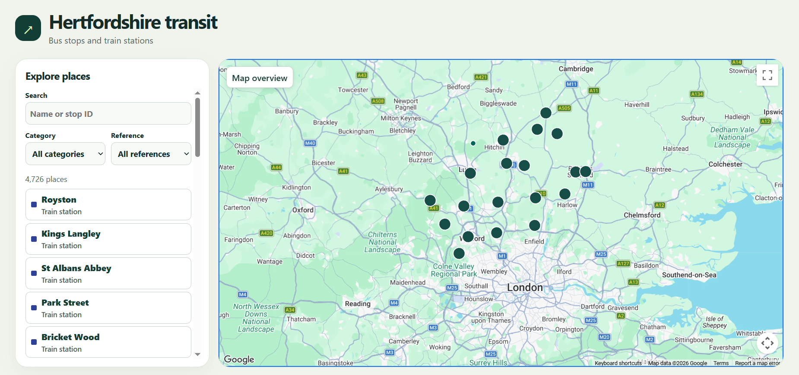

# Geospatial Fun | Hertfordshire Transit Explorer

An interactive map and searchable directory of **4,726 bus stops and railway stations** in the Hertfordshire transit dataset. Search by name or identifier, filter by category or reference, and select a result or a map marker to inspect the place.



## The problem

A GeoJSON file can describe thousands of locations, but it is difficult to browse directly. Drawing every location as a separate marker also made the map noticeably slower to pan and zoom when the full dataset was visible. The project needed to make those places easy to find, keep the map responsive, and avoid paid lookup requests every time someone typed or changed a filter.

The explorer loads a bundled dataset and uses it as the single source of truth for the map and list. The map groups nearby locations at overview zoom and shows individual places as the user zooms in. The list remains searchable even if the map is unavailable.

## Key engineering decisions

| Technology | Role in the solution |
| --- | --- |
| React and CSS | Keep filters, selection and the map in sync. On smaller screens, the results panel collapses to give the map more room. Long lists scroll within the panel so the page fits the viewport. |
| TypeScript and GeoJSON | Validate the collection and its point features at the data boundary. Convert GeoJSON's longitude-first coordinates into a typed `TransitPlace` model for the UI. |
| TanStack Query | Load the local asset through a shared query with request cancellation and explicit loading and error states. The bundled data stays fresh in cache for as long as the cache entry exists. |
| Google Maps JavaScript API | Supply the basemap and render the local point layer. Share the script load and keep one map instance per mounted view across filter changes and React re-renders. |
| Vite and Yarn | Run the development server and produce a static build, with a pinned package manager and lockfile for reproducible installs. |
| Vitest and React Testing Library | Exercise data validation, query behaviour, user interactions and Maps lifecycle rules. Test doubles cover Maps without a live key or billable requests. |
| OpenSpec | Record requirements, design decisions and verification alongside the code. Completed changes are archived, and the current specifications remain available in the repository. |

### Performance and cost

At zoom level 10, **61 markers and groups represent all 4,726 places**. This is a count of overlays produced for the bundled dataset. At closer zoom levels the layer limits drawing to the current viewport. The map waits for camera movement to settle before updating dense results, then reuses unchanged features and their styles. The selected place remains individually visible.

Search, filtering and details use the local dataset. The app makes no Places, Autocomplete, Geocoding or Routes requests. It keeps one Maps bootstrap attempt per page load, retains script or authentication failure for that page, and disables Street View. **Loading the basemap can still incur charges.** [Google Maps JavaScript API usage and billing](https://developers.google.com/maps/documentation/javascript/usage-and-billing)

## Run locally

Use **Node.js 24.15 or later in the 24.x series** and **Yarn 4.9.2**. From the repository root:

```sh
yarn install --immutable
yarn dev
```

Open the address printed by Vite, normally `http://localhost:5173`. Without an API key, the app shows the map fallback and you can still browse, search and filter the places.

### Enable the interactive map

1. In Google Cloud, select a project with billing enabled and enable **Maps JavaScript API**. Create a browser API key, restrict it to **Maps JavaScript API**, and apply a **Websites** restriction for your local dev origin and any deployed origins. [Google Maps API key setup](https://developers.google.com/maps/documentation/javascript/get-api-key)
2. Create a `.env.local` file in the repository root and replace the placeholder with your restricted browser key.

   ```dotenv
   VITE_GOOGLE_MAPS_API_KEY=your_restricted_browser_key
   ```

3. Restart the development server. For a deployment, set the variable before building and serve the `dist/` directory at the site root so `/data/herts-transit.geojson` resolves correctly.

Vite exposes `VITE_` variables to the browser bundle. Keep your local configuration out of version control and use the Google Cloud API and website restrictions to control where the key can be used. [Vite environment variables](https://vite.dev/guide/env-and-mode.html)

## Test and build

| Command | Purpose |
| --- | --- |
| `yarn test` | Run the full test suite once. |
| `yarn test:watch` | Rerun related tests while developing. |
| `yarn build` | Type-check the project and generate `dist/`. |
| `yarn preview` | Preview the production build locally. |

The tests cover malformed GeoJSON, request cancellation and HTTP errors, local filters, map fallbacks, duplicate Maps initialisation, clustering and repeat selection. The production layout was also checked in Chromium at desktop and mobile sizes with external requests blocked.

## Explore the code

- [Bundled transit dataset](public/data/herts-transit.geojson)
- [Data loader](src/lib/transitData.ts), [GeoJSON mapper](src/lib/transitMapper.ts) and [query hook](src/hooks/useTransitPlaces.ts)
- [Explorer UI](src/components/TransitExplorer.tsx), [map component](src/components/TransitMap.tsx) and [clustering logic](src/lib/transitMapPoints.ts)
- [OpenSpec specifications](openspec/specs) and [completed changes](openspec/changes/archive)

## Data and attribution

The bundled data is a snapshot of stop and station locations. It contains no live departures, timetables or route geometry. References and operator details are shown where the source provides them.

Transit location data © [OpenStreetMap contributors](https://www.openstreetmap.org/copyright). The basemap is supplied by Google Maps.
